 

  

 

## ⚡ What I build

<table>
<tr>
<td width="50%" valign="top">

### 📨 Messaging at scale
Campaign pipelines for multi-million-recipient sends: shared send budgets, per-chunk job fan-out, and recovery of jobs orphaned by deploys.

</td>
<td width="50%" valign="top">

### 🔌 Integrations
Shopify, Shopware 6, WooCommerce, Magento, Klaviyo, HubSpot, Zendesk and Emarsys, with OAuth, idempotent webhooks, retries and rate limits.

</td>
</tr>
<tr>
<td width="50%" valign="top">

### 💬 WhatsApp Cloud API
Meta Embedded Signup, WABA onboarding, template management and status-webhook processing.

</td>
<td width="50%" valign="top">

### 🛡️ Reliability & security
Secret-safe logging, run-time credential resolution, Sentry triage and structured logs with correlation IDs.

</td>
</tr>
</table>

## 🧰 Stack

Also: BullMQ · Socket.io · Joi/Zod · Mongoose · Atlas Search · Sentry · PM2

## 🔥 Activity

  

<picture>
  <source media="(prefers-color-scheme: dark)" srcset="https://raw.githubusercontent.com/Dokakoka/Dokakoka/output/github-snake-dark.svg" />
  <source media="(prefers-color-scheme: light)" srcset="https://raw.githubusercontent.com/Dokakoka/Dokakoka/output/github-snake.svg" />
  
</picture>

Most of my work lives in private company repositories.

## 🧭 Right now

- 🔭 Building public side projects around queues, webhooks and WhatsApp tooling
- 🌱 Going deeper on distributed systems and LLM tooling
- 💼 Looking for a **remote** full-stack / back-end role with a product team

 
Thanks for stopping by ✌️

